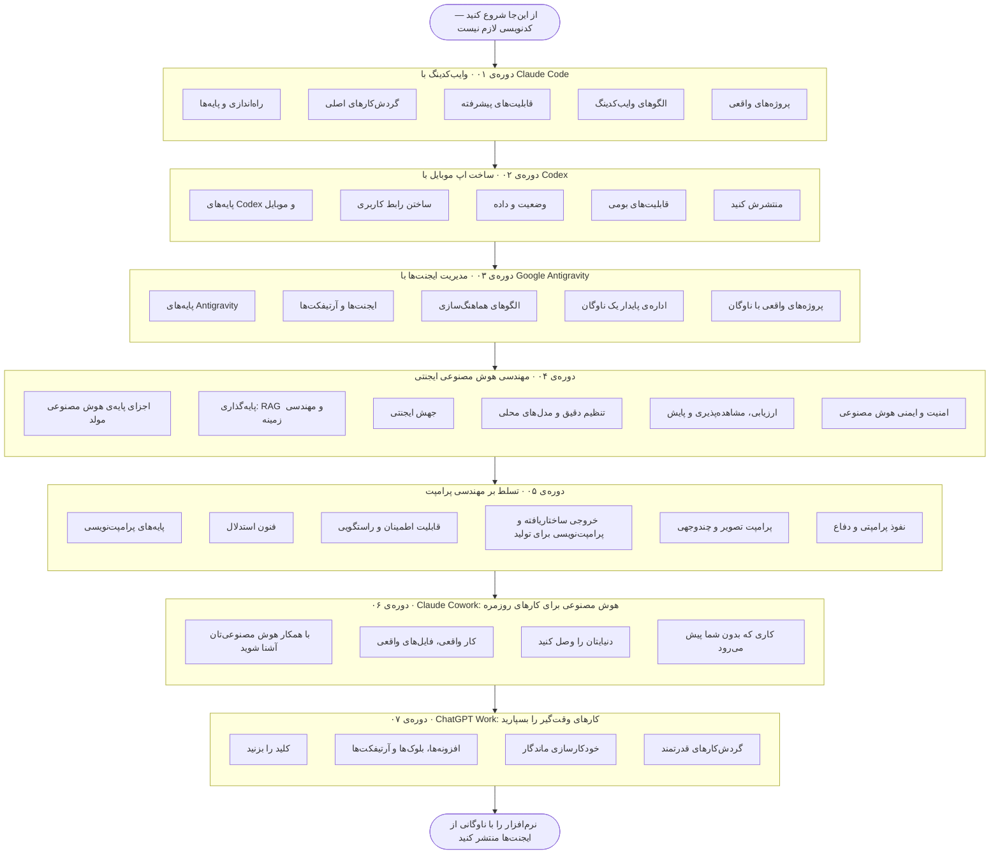

<!-- GENERATED FILE — do not edit by hand.
     Source: lib/courses.ts in the Vibe Code School site (scripts/export-oss.mts).
     Content PRs are welcome: edits get applied to the site source and re-exported.
     Persian translation of the upstream file (CC BY-SA 4.0) — see TRANSLATION.md. -->

> **یادداشت ترجمه:** ترجمه‌ی فارسیِ [roadmap/README.md](https://github.com/dineshxr/vibecodeschool/blob/main/roadmap/README.md)
> از مخزن اصلی، تحت CC BY-SA 4.0. دوره‌های تعاملی روی سایت فعلاً به انگلیسی‌اند.

# نقشه‌ی راه وایب‌کدینگ (۲۰۲۶)

۱۷۰ درس رایگان. ۷ دوره. یک مسیر — از اولین پرامپت تا هماهنگ‌کردن ناوگانی از ایجنت‌های هوش مصنوعی.
نسخه‌ی تعاملی با پیگیری پیشرفت در
**[vibecodeschool.com/roadmap](https://vibecodeschool.com/roadmap)** است.

## مسیرها

### ۰۱. وایب‌کدینگ با Claude Code

از اولین `/init` تا دیپلوی پروژه‌ی پایانی. Claude Code به‌عنوان ابزار روزانه‌تان: همه‌ی الگوهای پرامپت،
همه‌ی گردش‌کارها، همه‌ی محافظ‌ها.

*مقدماتی · ۲۸ درس · حدود ۱۴ ساعت · [نسخه‌ی تعاملی](https://vibecodeschool.com/courses/claude-code-vibe-coding) · [سرفصل](../courses/claude-code-vibe-coding/README.md)*

1. **راه‌اندازی و پایه‌ها** — ابزار خط فرمان را نصب کنید، چرخه را یاد بگیرید، حافظه‌ی پروژه را راه بیندازید. در پایان این بخش آماده‌ی کارید.
2. **گردش‌کارهای اصلی** — چرخه‌های روزمره‌ای که کدنویسی ایجنتی را از تایپ کردن سریع‌تر می‌کنند.
3. **قابلیت‌های پیشرفته** — دستورهای اسلش، مهارت‌ها، زیرایجنت‌ها، حالت برنامه‌ریزی، هوک‌ها و MCP — ابزارهایی که Claude Code را با گردش‌کار شما هماهنگ می‌کنند.
4. **الگوهای وایب‌کدینگ** — پرامپت‌ها و ریتم‌هایی که اثرشان روی هم انباشته می‌شود. تفاوت یک وایب‌کدر باتجربه با یک گردشگر.
5. **پروژه‌های واقعی** — مطالعه‌های موردی با چرخه‌ی کامل. نه مثال‌های اسباب‌بازی — کار واقعی و قابل انتشار.

### ۰۲. ساخت اپ موبایل با Codex

React Native / Expo از صفر، با Codex پشت فرمان. احراز هویت، پرداخت، اعلان‌های پوش، ماژول‌های بومی —
همه با پرامپت‌هایی که کد واقعی و قابل بازبینی تولید می‌کنند.

*متوسط · ۲۵ درس · حدود ۱۸ ساعت · [نسخه‌ی تعاملی](https://vibecodeschool.com/courses/codex-mobile-apps) · [سرفصل](../courses/codex-mobile-apps/README.md)*

1. **پایه‌های Codex و موبایل** — Codex را نصب کنید، اسکلت یک اپ Expo را بسازید، محدودیت‌های موبایل در برابر وب را بشناسید.
2. **ساختن رابط کاربری** — صفحه‌ها، ناوبری، فرم‌ها، پوسته‌ها — سطح دیدنی اپ شما.
3. **وضعیت و داده** — محلی، سراسری، آفلاین و زنده — داده چطور در یک اپ واقعی جابه‌جا می‌شود.
4. **قابلیت‌های بومی** — قابلیت‌هایی که حس یک اپ واقعی می‌دهند، نه وب‌سایتی که در پوسته‌ی اپ پیچیده شده.
5. **منتشرش کنید** — از شبیه‌ساز محلی تا App Store / Play Store، با آزمایش انسانی در میانه‌ی راه.

### ۰۳. مدیریت ایجنت‌ها با Google Antigravity

Google Antigravity از سر تا ته: دو محیط ویرایشگر (Editor) و مدیر ایجنت (Agent Manager)، آرتیفکت‌ها و
تأیید در مرورگر، ایجنت‌های موازی روی ورک‌تری‌ها، دانشی که انباشته می‌شود — و عادت‌هایی که باعث می‌شوند
داشتن یک ناوگان واقعاً بیرزد.

*پیشرفته · ۲۵ درس · حدود ۲۰ ساعت · [نسخه‌ی تعاملی](https://vibecodeschool.com/courses/antigravity-agent-manager) · [سرفصل](../courses/antigravity-agent-manager/README.md)*

1. **پایه‌های Antigravity** — IDE را نصب کنید، با دو محیطش آشنا شوید، اولین کار مدیر ایجنت را اجرا کنید، میزان خودمختاری را تنظیم کنید.
2. **ایجنت‌ها و آرتیفکت‌ها** — برنامه‌ها، اجرا، تأیید، انتشار و پایگاه دانش — واژگان کاری توسعه‌ی ایجنت‌محور.
3. **الگوهای هماهنگ‌سازی** — ترتیب‌دهی، ورک‌تری‌های موازی، نظر دوم، هدایت و صندوق ورودی. جریان کنترل یک ناوگان.
4. **اداره‌ی پایدار یک ناوگان** — مدل‌ها و محدودیت نرخ، ردپای ممیزی، حالت‌های شکست، امنیت، و سه معیاری که بهره‌وری را واقعی نگه می‌دارند.
5. **پروژه‌های واقعی با ناوگان** — از ایشو تا درخواست ادغام، همگام‌سازی مستندات، اولویت‌بندی موازی، مهاجرت با ورک‌تری، پروژه‌ی پایانی. گردش‌کارهایی که واقعاً اجرا خواهید کرد.

### ۰۴. مهندسی هوش مصنوعی ایجنتی

از توکن‌ها تا محیط تولید: مبانی مدل‌های زبانی بزرگ (LLM)، RAG و مهندسی زمینه، معماری‌های ایجنتی با MCP و
A2A، هماهنگ‌سازی با LangGraph، تنظیم دقیق با LoRA و مدل‌های محلی با Ollama، ارزیابی‌ها و مشاهده‌پذیری،
و لایه‌ی امنیت — دفاع در برابر تزریق، محافظ‌ها، آزمون تیم قرمز، حاکمیت.

*متوسط · ۲۵ درس · حدود ۱۶ ساعت · [نسخه‌ی تعاملی](https://vibecodeschool.com/courses/agentic-ai) · [سرفصل](../courses/agentic-ai/README.md)*

1. **اجزای پایه‌ی هوش مصنوعی مولد** — توکن‌ها، پرامپت‌نویسی، فراخوانی تابع، خروجی‌های ساختاریافته، پشته‌ی مدرن — و بودجه‌های تأخیر، هزینه و قابلیت اطمینان که همه چیز را شکل می‌دهند.
2. **پایه‌گذاری: RAG و مهندسی زمینه** — پنجره‌ی زمینه را گزینش کنید، پاسخ‌ها را به داده‌های خودتان تکیه دهید، و بدانید کدام الگوهای پیشرفته‌ی بازیابی ارزش پیچیدگی‌شان را دارند.
3. **جهش ایجنتی** — از گردش‌کار تا ایجنت: الگوهای معماری، MCP برای ابزارها، A2A برای همتایان، و LangGraph وقتی هماهنگ‌سازی جدی می‌شود.
4. **تنظیم دقیق و مدل‌های محلی** — آموزش دادن کی به‌صرفه است، LoRA/QLoRA در عمل، و اجرای مدل‌های وزن‌باز به صورت محلی با Ollama.
5. **ارزیابی، مشاهده‌پذیری و پایش** — مجموعه‌داده‌های طلایی، تحلیل شکست، مدل زبانی در نقش داور (LLM-as-judge)، ردیابی، و چرخه‌ی ارزیابی در محیط تولید که پسرفت‌ها را پیش از کاربران پیدا می‌کند.
6. **امنیت و ایمنی هوش مصنوعی** — سطح تهدید، دفاع در برابر تزریق و نشت اطلاعات شخصی (PII)، محافظ‌هایی که در صورت خطا بسته می‌مانند، آزمون تیم قرمز، و حاکمیت — آمادگی برای تولید، به اثبات‌رسیده.

### ۰۵. تسلط بر مهندسی پرامپت

برنامه‌ی درسی کامل پرامپت‌نویسی: پایه‌ها، فنون استدلال، قابلیت اطمینان، خروجی ساختاریافته، پرامپت تصویر و
چندوجهی، و لایه‌ی امنیت — نفوذ پرامپتی و چگونگی دفاع در برابرش. ۳۵ درس، همه عملی، و هر فن روی
پیشرفته‌ترین مدل‌های فعلی آزموده شده.

*مقدماتی · ۳۵ درس · حدود ۲۴ ساعت · [نسخه‌ی تعاملی](https://vibecodeschool.com/courses/prompt-engineering) · [سرفصل](../courses/prompt-engineering/README.md)*

1. **پایه‌های پرامپت‌نویسی** — اجزای کاری یک پرامپت — دستورهای دقیق، جداکننده‌ها، نقش‌ها و مثال‌ها — که در قالب قراردادهایی کنار هم می‌نشینند که زیر ورودی واقعی دوام می‌آورند.
2. **فنون استدلال** — کاری کنید مدل‌ها روند کارشان را نشان دهند و بهترش کنند: زنجیره‌ی تفکر، تجزیه‌ی مسئله، رأی‌گیری میان نمونه‌ها، و جاهایی که مدل‌های استدلالی ۲۰۲۶ قواعد بازی را عوض می‌کنند.
3. **قابلیت اطمینان و راستگویی** — چرا مدل‌ها چیز می‌سازند، و راهکارهایی که در عمل جواب می‌دهند: خودداری سنجیده از پاسخ، چرخه‌های نقد، ترکیب چند مدل، کاهش سوگیری، و مجموعه‌های آزمون پرامپت.
4. **خروجی ساختاریافته و پرامپت‌نویسی برای تولید** — پرامپت‌هایی که در محیط تولید زنده می‌مانند — قراردادهای سخت‌گیرانه‌ی خروجی، الگوهای زمینه‌ی طولانی و RAG، پرامپت سیستمی ایجنت‌ها، فراپرامپت‌نویسی، و نسخه‌بندی.
5. **پرامپت تصویر و چندوجهی** — پرامپت فراتر از متن — تولید تصویر با کنترل، هدایت با پرامپت منفی و وزن‌ها، خواندن تصویر به‌عنوان ورودی، و مرزهای صدا و ویدیو.
6. **نفوذ پرامپتی و دفاع** — لایه‌ی امنیتی که هر سازنده‌ای لازم دارد — تزریق پرامپت، جیلبریک و نشت پرامپت چطور کار می‌کنند، و چطور از اپ خودتان دفاعی چندلایه کنید.

### ۰۶. Claude Cowork: هوش مصنوعی برای کارهای روزمره

Claude Code برنامه‌نویسی را عوض کرد؛ Cowork همان چرخه‌ی ایجنتی را برای بقیه‌ی آدم‌ها می‌آورد. یاد بگیرید
کارهای دانشی واقعی را به Claude بسپارید: فضای کاری بسازید، بر چرخه‌ی تأیید مسلط شوید، صفحه‌گسترده‌هایی
بسازید که خودشان را بررسی می‌کنند، ابزارهایتان را وصل کنید، مهارت یاد بدهید، کارهایی زمان‌بندی کنید که
وقتی خوابید اجرا می‌شوند، و همه را در قالب سیستم‌های دائمی کنار هم بگذارید. بدون ترمینال، بدون کد —
ساخته‌شده برای تازه‌کارها.

*مقدماتی · ۱۶ درس · حدود ۹ ساعت · [نسخه‌ی تعاملی](https://vibecodeschool.com/courses/claude-cowork) · [سرفصل](../courses/claude-cowork/README.md)*

1. **با همکار هوش مصنوعی‌تان آشنا شوید** — Cowork چیست، راه‌اندازی‌اش، اولین کار واقعی‌تان، و چرخه‌ی تأییدی که کنترل را دست شما نگه می‌دارد.
2. **کار واقعی، فایل‌های واقعی** — مهارت در کار با پوشه‌ها، اسناد اداری، صفحه‌گسترده‌هایی که خودشان را بررسی می‌کنند، و پژوهش با منابع قابل بررسی.
3. **دنیایتان را وصل کنید** — کانکتورها و افزونه‌ها، پروژه‌ها و حافظه، مهارت‌های قابل استفاده‌ی دوباره، و پیش‌نمایش‌های کار با مرورگر و رایانه.
4. **کاری که بدون شما پیش می‌رود** — جلسه‌های ابری، هدایت از گوشی، کارهای زمان‌بندی‌شده، و ترکیب همه در قالب سیستم‌های دائمی هوش مصنوعی.

### ۰۷. ChatGPT Work: کارهای وقت‌گیر را بسپارید

ChatGPT Work، ChatGPT را از اپی که جواب می‌دهد به ایجنتی تبدیل می‌کند که کار تمام‌شده تحویل می‌دهد. با اجرای
چهارمرحله‌ای، چرخه‌ی ویرایش، افزونه‌ها و @-اشاره‌ها، بلوک‌ها و نمودارها، خودکارسازی‌های زمان‌بندی‌شده،
مرورگر ایجنت، صدا و کنترل از راه دور، و قواعد ابری در برابر محلی که خودکارسازی‌ها را قابل اعتماد می‌کنند
آشنا شوید — و در پایان، آزمایشی سنجیده روی یک گردش‌کار واقعی اجرا کنید. مناسب تازه‌کارها، بدون کد.

*مقدماتی · ۱۶ درس · حدود ۹ ساعت · [نسخه‌ی تعاملی](https://vibecodeschool.com/courses/chatgpt-work) · [سرفصل](../courses/chatgpt-work/README.md)*

1. **کلید را بزنید** — Work چیست، اجرای چهارمرحله‌ای، اولین ارائه‌ی پژوهشی‌تان، و چرخه‌ی ویرایش.
2. **افزونه‌ها، بلوک‌ها و آرتیفکت‌ها** — اپ‌هایتان را وصل کنید، در قالب بلوک و نمودار پیش‌نویس کنید، صفحه‌گسترده‌های قابل اعتماد بسازید، و تصویرها را مثل یک بازبین ویرایش کنید.
3. **خودکارسازی ماندگار** — کارهای زمان‌بندی‌شده، خلبان خودکار صندوق ایمیل، مرورگر ایجنت و کار با رایانه، و Sites.
4. **گردش‌کارهای قدرتمند** — ابری در برابر محلی، صدا و کنترل از راه دور، فضاهای کاری چندایجنتی، و یک آزمایش پایانی سنجیده.

## پرسش‌های متداول

<strong>در ۲۰۲۶ یادگیری وایب‌کدینگ را از کجا شروع کنم؟</strong>

با یک ایجنت و یک پروژه‌ی واقعی شروع کنید. نقشه‌ی راه ما با Claude Code در ترمینال شروع می‌شود: چرخه را
یاد می‌گیرید (نتیجه را توصیف کن، دیف را بازبینی کن، اصلاح کن، تکرار کن)، بعد الگوهای پرامپت، حالت
برنامه‌ریزی، هوک‌ها و MCP. از آن‌جا مسیر به انتشار یک اپ موبایل با OpenAI Codex می‌رسد، و در نهایت به
هماهنگ‌کردن ناوگانی از ایجنت‌ها با Google Antigravity.

<strong>یادگیری وایب‌کدینگ چقدر طول می‌کشد؟</strong>

کل نقشه‌ی راه حدود ۹۲ ساعت کار هدایت‌شده است — یعنی ۶ تا ۱۰ هفته به صورت پاره‌وقت. دوره‌ی ۰۱ (Claude Code،
حدود ۱۴ ساعت) شما را در همان هفته‌ی اول بهره‌ور می‌کند؛ دوره‌ی ۰۲ (موبایل با Codex، حدود ۱۸ ساعت) و
دوره‌ی ۰۳ (Antigravity، حدود ۲۰ ساعت) شما را به سمت انتشار نرم‌افزار برای محیط تولید و اجرای موازی
ایجنت‌ها می‌برند؛ دوره‌ی ۰۴ (مهندسی هوش مصنوعی ایجنتی، حدود ۱۶ ساعت) لایه‌ی سیستمی را یاد می‌دهد — RAG،
ارزیابی‌ها و امنیت هوش مصنوعی؛ دوره‌ی ۰۵ (تسلط بر مهندسی پرامپت، حدود ۲۴ ساعت) را می‌توانید هم‌زمان با هر
کدام بگذرانید.

<strong>پیش از شروع باید کدنویسی بلد باشم؟</strong>

نه. دوره‌ی ۰۱ هیچ پیش‌زمینه‌ی کدنویسی فرض نمی‌کند — ایجنت کد را می‌نویسد و دوره به شما یاد می‌دهد مشخص
کنید، بازبینی کنید و هدایت کنید. آشنایی پایه با وب یا موبایل در دوره‌های بعدی کمک می‌کند، اما هر درس
مفاهیمی را که به آن‌ها می‌پردازد در همان‌جا توضیح می‌دهد.

<strong>این نقشه‌ی راه وایب‌کدینگ رایگان است؟</strong>

بله. هر ۱۷۰ درس در هفت دوره رایگان‌اند، بدون ثبت‌نام و بدون دیوار پرداخت. پیشرفت، امتیاز، روزهای پیاپی و
نشان‌ها در مرورگر خودتان ذخیره می‌شوند.

<strong>این نقشه‌ی راه به کدام شغل‌های هوش مصنوعی می‌رسد؟</strong>

مهارت‌های این‌جا مستقیماً به نقش‌های تازه‌ی عصر هوش مصنوعی می‌خورند: وایب‌کدر، Forward Deployed Engineer،
مهندس ایجنت، مهندس تحول هوش مصنوعی و بیشتر. نقشه‌های راه شغلی ما را در vibecodeschool.com/careers ببینید:
ده مسیر نقش‌به‌نقش با حقوق‌ها، مهارت‌ها و نقاط بررسی برای اثبات توانایی.

<strong>اول کدام ابزار کدنویسی هوش مصنوعی را یاد بگیرم: Claude Code، Codex یا Cursor؟</strong>

پیشنهاد ما یک ایجنت ترمینال‌محور مثل Claude Code پیش از یک IDE مثل Cursor است: مجبورتان می‌کند در سطح
نیت کار کنید نه تکمیل خودکار، و این مهارت اصلی وایب‌کدینگ است. Codex و Antigravity بعد همین مهارت را
تعمیم می‌دهند — چرخه یکی است، پس عوض کردن ابزار در آینده ارزان تمام می‌شود.

---

⭐ اگر این نقشه‌ی راه به کارتان آمد، به [مخزن اصلی ستاره بدهید](https://github.com/dineshxr/vibecodeschool) — یادگیرنده‌های دیگر این‌طور پیدایش می‌کنند.

